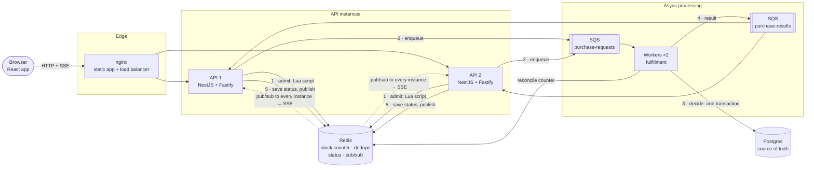
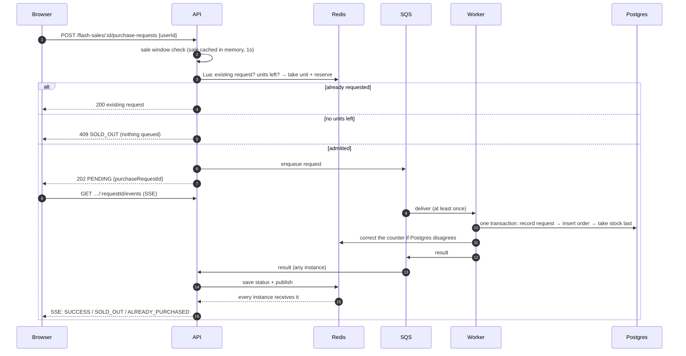

# Flash Sale Demo

A flash sale for one product with limited stock, where each user can buy at most one unit.
It is built to stay correct when tens of thousands of people click "Buy now" in the same
second: **no overselling, one item per user, nothing lost**, verified by stress tests.

- **Backend:** NestJS (Fastify) API and worker, TypeScript, Node 24
- **Frontend:** React, Vite, Tailwind, shadcn/ui
- **Data and messaging:** Postgres (source of truth), Redis (admission and live status),
  SQS (purchase queue; ElasticMQ locally)
- **Tests:** Jest and Vitest for unit and integration tests, k6 for stress tests

## Contents

1. [Quick start](#quick-start)
2. [Architecture](#architecture)
3. [How a purchase works](#how-a-purchase-works)
4. [Correctness: where each guarantee is enforced](#correctness-where-each-guarantee-is-enforced)
5. [Fault tolerance](#fault-tolerance)
6. [Design choices and trade-offs](#design-choices-and-trade-offs)
7. [Stress test results](#stress-test-results)
8. [Running locally and testing](#running-locally-and-testing)
9. [API](#api)
10. [Project structure](#project-structure)
11. [Future improvements](#future-improvements)

## Quick start

Requirements: Docker, Node 24 and pnpm 10 (`corepack enable`).

```bash
cp .env.example .env
pnpm install
pnpm stack:up                 # Postgres, Redis, SQS, 2 APIs behind nginx, 2 workers
pnpm db:seed                  # a sale with 1,000 units that starts now and lasts 5 minutes
open http://localhost:8080
```

`pnpm db:seed --stock 100 --starts-in 1m --duration 10m` configures the sale window and stock.
Add `--reset` to start from a clean slate. It also clears the queues and Redis.

> The `stack:*` and `infra:*` scripts call `docker-compose`. With Compose v2, run
> `docker compose up -d --build` instead. Compose v1.29 has a known `'ContainerConfig'` error
> when it recreates containers on newer Docker engines; `docker-compose down` first avoids it.

## Architecture



| Component | Role | Cloud equivalent |
|---|---|---|
| nginx | Serves the React build and load-balances `/api` across instances; SSE passthrough | CloudFront + S3, ALB |
| API (×N) | Validates, admits through Redis, enqueues, streams results over SSE. Stateless | ECS / EKS service |
| Worker (×N) | Consumes purchase requests and makes the authoritative decision in Postgres | ECS service or Lambda |
| Postgres | Orders, stock, request history. Its constraints guarantee correctness | RDS / Aurora |
| Redis | Stock counter and dedupe for fast admission, live request status, pub/sub fan-out | ElastiCache |
| SQS | Buffers the spike between API and workers; results queue back to the API | Amazon SQS |

Everything runs locally in Docker. ElasticMQ stands in for SQS because it speaks the same API,
so the code uses the real AWS SDK and only the endpoint changes. It is also a small image
(unlike LocalStack) and declares queues and dead-letter queues in
[one config file](infrastructure/docker/elasticmq.conf).

## How a purchase works



The API answers in milliseconds. Requests that cannot win (sold out, duplicate, outside the
window) never reach the queue or the database. Everything else waits in SQS, so a spike costs
queue depth, not errors.

## Correctness: where each guarantee is enforced

**Redis admits, Postgres decides.** The API's checks are fast filters. The worker re-checks
everything in Postgres and never assumes the API's checks happened.

| Guarantee | Fast filter (API, Redis) | Final guarantee (worker, Postgres) |
|---|---|---|
| No overselling | Atomic stock counter in a Lua script | `UPDATE … SET remaining_stock = remaining_stock - 1 WHERE remaining_stock > 0`, backed by `CHECK (remaining_stock >= 0)` |
| One item per user | `user → request` key in the same Lua script | `UNIQUE (flash_sale_id, user_id)` on orders |
| Sale window | Cached sale, checked at accept time | Re-checked against the request's `acceptedAt` |
| Exactly-once effect under at-least-once delivery | — | `purchase_requests.id` primary key; a redelivery returns the earlier outcome |

Why the conditional `UPDATE` is enough: Postgres locks the row, and after a concurrent update
commits it re-evaluates the `WHERE` against the new value (READ COMMITTED). So the last unit
can only be taken once, and the losing transaction sees 0 rows updated and rolls its order
back. There is no read-then-write gap, so `SELECT … FOR UPDATE` isn't needed.

Every buyer shares that one stock row. The worker takes its lock **last** and commits right
after, so it is held for one `UPDATE` plus the `COMMIT`. The stress tests showed this
mattered: [~105 → ~162 purchases/s](apps/backend/test/stress/README.md).

The Redis counter can only drift in a safe direction:

- If the key is lost, it is re-seeded from Postgres and may admit a few too many. Postgres rejects the extras.
- If a crash happens between commit and reconciliation, the counter may stay one unit too low, so the sale can undersell by one. It never oversells.

## Fault tolerance

| Failure | What happens |
|---|---|
| Traffic above capacity | nginx sheds the excess with an immediate `429` and `Retry-After`, from one global budget set below the measured capacity, so the instances keep answering in milliseconds instead of collapsing. The frontend shows "busy, try again in a moment" |
| An API instance dies | nginx routes around it: a 2s connect timeout and a retry on the other instance, and Docker DNS is re-resolved every 10s, so a stopped instance drops out. Busy instances are never marked dead (`max_fails=0`). Its SSE clients reconnect (EventSource) to another instance; results reach every instance through Redis pub/sub |
| A worker dies mid-transaction | The transaction rolls back. The message reappears after the 30s visibility timeout and another worker processes it |
| A worker dies after commit, before publishing the result | The redelivered message finds the recorded request and republishes the same outcome; nothing is applied twice |
| A message fails repeatedly (bad payload, bug) | After 5 receives it moves to a dead-letter queue for inspection. Redriving it is safe, because handling is idempotent |
| SQS unavailable at the API | The reservation is undone (unit and dedupe key returned) and the client gets `503`, so it can retry |
| Redis unavailable at the API | Fail closed: `503`. Admitting without Redis would be safe for correctness but floods the queue (see future improvements) |
| Redis loses data | Counter re-seeded from Postgres; duplicate buyers are still stopped by the unique constraint; status lookups fall back to Postgres |
| Postgres unavailable | The worker's transactions fail and messages are retried, so nothing is lost or decided wrongly. **Known gap:** after 5 attempts (~2.5 minutes at a 30s visibility timeout) they move to the dead-letter queue and need a redrive once Postgres is back. A longer retry policy would ride out longer outages |
| The user reloads or loses the connection | The status is stored, not only pushed: the page resumes from the saved status, SSE sends the current status on connect, and polling is the fallback |
| Shutdown or deploy | Consumers stop polling and finish in-flight messages before connections close; open SSE streams complete |

## Design choices and trade-offs

The main decisions, with the alternatives considered:

- **Asynchronous purchase through a queue, instead of a database write in the request.** The
  queue absorbs the spike, and the database load is set by the number of workers, not the
  traffic. *Cost:* the result arrives a moment later (SSE), and delivery is at least once,
  so the worker must be idempotent.
- **Postgres is the source of truth; Redis only filters traffic.** Correctness never depends
  on Redis durability. Making Redis authoritative with asynchronous database writes would be
  faster, but a Redis failover could lose writes and oversell. *Cost:* every sale pays one
  Postgres transaction per admitted buyer, about `stock` transactions in total.
- **Postgres over MongoDB.** MongoDB could do this correctly too: an atomic
  `findOneAndUpdate` with a `$gt` guard, unique indexes, and multi-document transactions.
  Postgres fits better here: the data is relational (product → sale → orders) and enforced
  with foreign keys, transactions are its default model rather than an add-on that needs a
  replica set, and `CHECK` and `UNIQUE` constraints are declared in one place as the last line
  of defence. In both databases, one hot stock record is updated one write at a time.
- **SSE plus Redis pub/sub for results.** SSE is one-way and plain HTTP, which is all a
  status push needs, so WebSockets aren't required. SQS delivers each result to one API
  instance, but the user may be connected to another, so pub/sub fans it out. Statuses are
  saved before publishing, so late subscribers and pollers still see them.
- **Approximately first-come-first-served.** A standard SQS queue processed in parallel
  doesn't preserve strict arrival order. Strict ordering needs a FIFO queue with one message
  group, which means serial processing. Differences are milliseconds, and the
  one-per-user and no-oversell guarantees are unaffected.
- **One stock row per sale.** It is simple and obviously correct, but purchases for one sale
  commit one at a time (about 160–190/s here). Splitting stock across rows
  ("buckets") is the next step if that ever matters. For a 1,000-unit sale it means about
  5 seconds to decide every buyer.
- **In-memory sale cache per API instance (1s TTL, concurrent misses merged).** Postgres
  sees at most one sale read per second per instance. A shared Redis cache would save
  little and add a network hop to every request.
- **Global load shedding instead of per-user rate limiting.** The danger in a flash sale is
  total traffic, not one noisy user: repeat clicks are already cheap, because the dedupe
  answers them from Redis. So nginx enforces one budget for the whole API, set below the
  capacity the stress tests measured, and answers the excess with a fast `429`. *Cost:* the
  limit depends on the deployment. It is a setting, not a constant: `API_RATE_LIMIT`
  (default 1,500 req/s, from 2 instances on a laptop) and `API_RATE_BURST` (default 500).
  Retune them from a capacity test whenever instances or hardware change. To measure raw
  capacity, turn shedding off with `API_RATE_LIMIT=100000 pnpm stack:up`.
- **Redis keys expire on their own.** A pending request's status lives for 24h. Once it is
  final, its status lives for 1h, which covers the post-sale "did I win?" rush; later
  lookups fall back to Postgres. The dedupe key stays for the whole sale.
- **Normalised data model:** `products` → `flash_sales` (stock allocated to a time-boxed
  sale) → `orders` and `purchase_requests`. "One per user" means one per sale.
- **The stock meter shows completed purchases**, from Postgres. For a few seconds it can
  show units left while new buyers already get `409 SOLD_OUT`, because queued requests hold
  those units.

## Stress test results

The k6 scenario sends a burst of purchase attempts to the current sale; 10% repeat an earlier
user (double clicks). After the burst, [verify.ts](apps/backend/test/stress/verify.ts) waits for
the queues to drain and checks the guarantees in Postgres. Full numbers and analysis are in
[apps/backend/test/stress/README.md](apps/backend/test/stress/README.md).

Laptop (WSL2, 16 cores, 8 GB), with k6 on the same machine:

| Setup | Scenario | Throughput | Latency p95 / p99 | Guarantees |
|---|---|---|---|---|
| 1 API, 1 worker | 1,000 units, 1,000 req/s × 30s | 928 req/s | 25 / 170 ms | ✓ |
| 2 APIs + nginx, 2 workers | 1,000 units, 2,000 req/s × 30s | 1,855 req/s, 0 errors | 154 / 256 ms | ✓ |
| 2 APIs + nginx, 2 workers | 50,000 units, all accepted | 436 req/s; worker ~194 purchases/s | 72 / 119 ms | ✓ |
| 2 APIs + nginx, **no load shedding** | 1,000 units, 2,500 req/s × 30s (overload) | ~60% `502`, cascade | 1–3 s / 4–6 s | ✓ |
| 2 APIs + nginx, **load shedding** | 1,000 units, 2,500 req/s × 30s (overload) | 2,250 req/s, **0 errors**; ~29k shed as `429` | 160–320 / 515 ms–2.1 s | ✓ |

The first three rows were measured before load shedding was added, to find the capacity it
is now set from.

Every run passed all checks:
- exactly `stock` orders, and never more;
- one order per buyer;
- every `202` processed exactly once;
- nothing dead-lettered;
- the Redis counter back at 0.

**Bottlenecks found and handled:**

1. **Worker lock time.** Profiling showed the stock-row lock held across three round trips;
   reordering the transaction made purchases about 1.55× faster.
2. **API CPU.** About 1,000 req/s per Node process; adding instances scales it roughly
   linearly.
3. **nginx failure handling.** The defaults hung for 60s on a stopped instance.
4. **Overload cascade.** Above capacity, slow-to-accept instances were marked dead, the other
   took double load and failed too: ~60% `502`s at 2,500 req/s. Fixed with global load
   shedding (1,500 req/s budget, burst 500) and never marking busy instances dead. The same
   overload now produces fast `429`s and zero errors.

**What's left:** one sale's purchases still commit one at a time on its stock row (about
190/s). A 1,000-unit sale is fully decided in about 5 seconds, which is acceptable here.

Run it yourself:

```bash
pnpm stack:up
BASE_URL=http://localhost:8080 RATE=2500 DURATION=30s STOCK=1000 pnpm stress
```

## Running locally and testing

Develop against the Docker infrastructure, with the apps on the host and hot reload:

```bash
cp .env.example .env
pnpm install
pnpm infra:up                 # Postgres :5433, Redis :6379, ElasticMQ :9324 (UI :9325)
pnpm db:migrate
pnpm db:seed
pnpm dev:api                  # http://localhost:3000
pnpm dev:worker
pnpm dev:web                  # http://localhost:5173 (proxies /api to :3000)
```

Tests:

```bash
pnpm test                                        # unit tests: backend (Jest) + frontend (Vitest)
pnpm --filter @flash-sale-demo/backend test:integration   # real Postgres, Redis and SQS (needs infra:up)
pnpm typecheck && pnpm lint
```

- **Integration tests** use their own database (`flashsale_test`), Redis DB 1 and test
  queues, so they don't touch dev data. They cover:
  - the HTTP API: status codes, dedupe, sell-out, enqueue failure, Redis failure;
  - the worker's transaction: 300 concurrent buyers for 50 units, one user × 25 concurrent
    requests, concurrent redeliveries;
  - the SSE notification flow.
- **Stress tests** need the API and worker running, either via `pnpm stack:up` with
  `BASE_URL=http://localhost:8080`, or via `pnpm build` and `start:api` / `start:worker`.
  See the [stress test README](apps/backend/test/stress/README.md). k6 runs from its Docker
  image, so it doesn't need to be installed.

## API

| Method and path | Response |
|---|---|
| `GET /api/flash-sales/current` | The running sale, or the next upcoming one, or the last ended one: status (`UPCOMING` / `ACTIVE` / `ENDED` / `SOLD_OUT`), product, window, stock, server time |
| `GET /api/flash-sales/:saleId` | The same, for a specific sale |
| `POST /api/flash-sales/:saleId/purchase-requests` `{ userId }` | `202` queued · `200` this user's existing request · `409 {status}` `SOLD_OUT` / `SALE_NOT_ACTIVE` · `400` invalid user · `429` overloaded, retry (from nginx) · `503` retry |
| `GET /api/flash-sales/:saleId/purchase-requests?userId=` | "Did this user secure an item?": the user's request and its status, or `404` |
| `GET /api/flash-sales/:saleId/purchase-requests/:id` | A request's status |
| `GET /api/flash-sales/:saleId/purchase-requests/:id/events` | SSE: `status` events until final, `heartbeat` every 15s |
| `GET /api/health/live`, `/api/health/ready` | Liveness; readiness (Postgres and Redis) |

`userId` is a username or email, trimmed and lower-cased, so `Alice@x.com` and `alice@x.com`
are the same buyer. Final statuses: `SUCCESS`, `ALREADY_PURCHASED`, `SOLD_OUT`,
`SALE_NOT_ACTIVE`.

## Project structure

```
apps/
  backend/
    src/
      main.api.ts, main.worker.ts, main.migrate.ts   one image, three entrypoints
      common/          config (zod-validated env), logging, message contracts, utils
      infrastructure/  Postgres (Drizzle schema + migrations), Redis, SQS clients
      modules/
        sale/          sale status, cached reads, Redis stock counter corrections
        purchase/      admission (Redis Lua), enqueue, status lookups
        fulfillment/   worker: the authoritative purchase transaction
        notification/  results consumer, pub/sub bus, SSE stream
        health/
    test/              integration tests (*.int-spec.ts) and stress/ (k6 + verify)
    scripts/seed.ts    creates a sale (stock, start, duration, --reset)
  frontend/
    src/features/flash-sale/   page, hooks (sale, purchase, server clock), SSE client
packages/shared-types/         API contracts shared by backend and frontend
infrastructure/docker/         nginx and ElasticMQ config
```

The backend follows NestJS feature modules. `infrastructure/` holds the clients for
external systems, and `common/` holds cross-cutting code without business rules.
Repositories use Drizzle directly rather than sitting behind interfaces; that is a
deliberate simplification for a service this size.

## Future improvements

- **Stock buckets:** split the product's stock across N rows and take a unit from a random
  row that still has stock, with `FOR UPDATE SKIP LOCKED`, so N purchases can commit in
  parallel. Each row keeps the same `remaining > 0` guard and `CHECK`, so it is still
  impossible to oversell. The costs: "sold out" now means *every* bucket is empty (not just
  the unlocked ones), the stock meter becomes a `SUM`, and the last few units queue on the
  last buckets again. Time to decide every buyer at ~190 decisions/s per row:

  | Stock | 1 row (today) | 10 buckets |
  |---|---|---|
  | 1,000 | ~5 s | ~0.5 s |
  | 10,000 | ~53 s | ~5 s |
  | 100,000 | ~9 min | ~53 s |

  For a 1,000-unit sale, one row is fast enough, so this stays a documented next step.
- **Circuit breaker for Redis:** today a Redis outage stops sales (fail closed). A fail-open
  breaker could queue directly. That is safe because the worker revalidates in Postgres;
  the cost is no API-side filtering and a larger backlog.
- **Longer worker retries:** a higher `maxReceiveCount` or exponential backoff, so a
  Postgres outage of many minutes doesn't push messages into the dead-letter queue.
- **Adaptive load shedding:** derive the limit from live latency or queue depth instead of
  a fixed number tuned by stress tests.
- **Bot protection and authentication:** real user identity (today `userId` is
  self-declared), CAPTCHA or a waiting room for very large drops.
- **Observability:** metrics for queue depth, decision latency, counter drift and DLQ size,
  with alerts.
